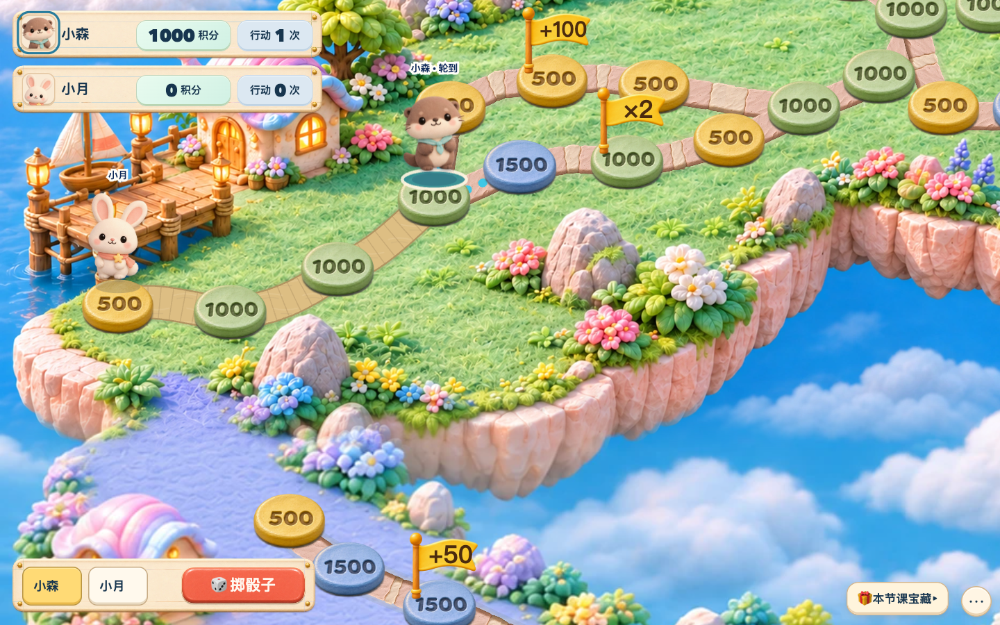

# 大富翁视觉更新 · 给设计 AI 的交接

日期：2026-11-12。此仓库保存本机当前工作区的源码快照，包含尚未上线的黏土风样板；不是线上版本的逐字镜像。本次授权为上传 GitHub 供设计交接，不包含部署。原 Gitee、线上服务与本地未提交工作继续保留。

## 先看这些

1. [AGENTS.md](AGENTS.md)：当前产品要求与不可改变的规则，按其中最新日期的明确决定理解历史文档。
2. [README.md](README.md)：独立游戏的目录、构建和平台依赖。
3. [本地黏土样板说明](docs/LOCAL_CLAY_PREVIEW.md)与[视觉验收记录](design-qa.md)：当前已有的探索及用户纠正，不代表用户已确定下一版设计方向。
4. [现有概念参考图](art-source/cloud-harbor/clay-preview/selected-reference.png)：参考图不等于已实现的页面，也不是可直接覆盖交互棋盘的背景。

根目录 `DESIGN.md` 是另一个 Word Attack 防线游戏的遗留规范；`docs/design/monopoly-design-optimization-v1.md` 是 2026-10-19 历史提案，含已取消设施和旧积分。两者均不能当作本次大富翁的当前要求。

## 当前实际画面

以下是 2026-11-10 本地虚拟学生样板的浏览器截图，保留实际画面，供了解现状。它们不是线上截图，也不是本次重新设计的结果。桌面与手机截取于不同体验时刻。



[手机实际画面](docs/design/screenshots/clay-preview-mobile.png)

普通地址使用现有水晶云港美术；本地显式 `visualPreview=clay` 才使用黏土样板，编辑器不启用。样板启航海湾背景为 v4，其余三区为 v2 草稿，仍需后续细化和接缝验收。

## 获取并查看

使用 Node.js 20+，在仓库根目录运行：

```bash
npm ci --ignore-scripts --no-audit --no-fund
npm run build
node scripts/preview-fixture.mjs
```

浏览器打开 `http://127.0.0.1:19422/games/monopoly/`。这是本仓库自带的虚拟学生基础界面预览，适合检查入口、选人及页面结构；不具备完整真实积分、平台账号或语音服务。

完整可玩的黏土实验室另用 `node scripts/qa/clay-preview.mjs`，并访问 `http://127.0.0.1:19422/games/monopoly/?visualPreview=clay&demo=1`。它依赖另一个项目的隔离 v3 平台源码：默认 `output/clay-preview/platform/server/index.js`，或通过 `MONOPOLY_LAB_PLATFORM_ROOT` 指定。该被忽略的平台副本不在此 GitHub 仓库，不能宣称仅克隆本仓库就能启动完整实验室。

`npm start` 是依赖平台登录服务的正式服务入口，默认使用 19421；19321 属于另一项目的平台服务。不要为设计预览去覆盖或重启这些服务。

## 主要文件

| 内容 | 位置 |
| --- | --- |
| 页面结构、现有 DOM 与交互挂点 | `public/prototypes/universal-board/index.html` |
| 主渲染、HUD、相机、交互编排 | `public/prototypes/universal-board/app.js` |
| 通用视觉、棋盘和控件 | 同目录 `styles.css`、`board-ui.css`、`setup-roster.css`、`play-controls.css` |
| 道路与贴地场景 | 同目录 `grounded-*.js` / `grounded-*.css` |
| 格价、奖励展示 | 同目录 `tile-points-visuals.js`、`special-cells-board.js` |
| 黏土样板 | 同目录 `clay-preview.js`、`clay-preview.css`、`clay-board.css` |
| 运行素材 | `public/assets/board-themes/cloud-harbor/` |
| 素材原图、提示词、哈希清单 | `art-source/cloud-harbor/` |
| 权威地图和版本化组合 | `public/prototypes/universal-board/packs.js`，不是任意改图的入口 |
| 服务端权威骰子、路线、落点与回执 | `standalone/points-*.mjs`，视觉更新复用已有接口 |

源码使用原生 ES Modules、SVG / DOM 与 CSS。构建会重写路径并生成忽略目录 `dist/`，不要手改构建结果。

## 设计时保留的边界

- 地图铺满游戏视口；学生卡、左下掷骰、右下操作与默认收起的宝藏列表叠在地图上。保留清楚的失败、恢复和待到账状态，不重新加回右侧骰子候场面板及普通节点说明牌。
- 当前基础格价为 **500 / 1000 / 1500 / 2500 / 5000**，五档颜色意义保留。只呈现真实金额，不引入旧金币/星星经济。黏土样板中数字已融入棋格材质，站人时也没有外置积分牌。
- 地图节点、边、分岔、道路与精确快照是权威数据。背景不得画出无法通行的假路，也不能烘焙可交互棋格、HUD 或文字。新背景先对照 `art-source/cloud-harbor/crystal-v2/layout-guides/` 与同目录整图控制指南。
- 骰子沿用用户认可的实心立方体；`tests/dice-look-lock.test.js` 锁定其代码和样式。新的样式表不得修改骰子或舞台。棋盘 SVG 不使用 CSS filter 或持续循环动画；保留低动态和素材失败回退。
- 老师主持：保存机会 → 服务端锁骰 → 必要选路 → 逐格移动 → 停稳存盘 → 领取已确认落点积分及既有效果 → 推进回合。浏览器不能指定骰点或凭动画发奖。
- 知识答题继续真人录音 → 服务端真实评分 → 先显示真实得分或不确定状态 → 合法骰子 → 逐格移动 → 最终落点。明确错误固定 45，证据不足为 null，不新增落点后的课堂题目或第二次评分。
- 保留双骰、额外前进与全班落格奖励队列、个人绕圈、全员完圈刷新、相同最终落格才自动选路、刷新恢复与原机会重试。视觉更新不能重算已到账、已锁回合、旧位置或历史回执。
- 不重新加入已取消的滑梯、弹床、大炮、水门、号角等设施。旧局按原精确规则恢复，不因换皮迁移旧存档。

相关当前规则见 `docs/SESSION_RECOVERY.md`、`AUTOMATIC_ROUTE_CHOICES.md`、`FIVEFOLD_TILE_POINTS.md`、`GROUP_LANDING_EFFECTS.md`、`DOUBLE_DICE_BONUS.md` 和 `CLOUD_HARBOR_CIRCUIT.md`（均在 `docs/`）。本交接是索引，不能替代完整合同。

## 验证及提交结果

本次上传前对当前工作区执行了 `npm run verify`：清单校验、构建及 **925 / 925** 测试通过，0 失败、0 跳过。旧 `design-qa.md` 中 915 项是此前验收记录。

请在独立分支提交视觉修改，说明修改文件、效果与验收证据。涉及实际页面时验证桌面、平板/窄屏、手机、键盘、低动态与缺图回退；按 `AGENTS.md` 运行相关门禁及 `npm run verify`。不要删除或放宽规则断言来通过验证。部署需由用户另行决定。

GitHub 使用当前文件的无历史快照，原本机基准为 `09e0179`，并包含本次上传前已存在的未提交改动。未包含 `.env`、运行数据、账号凭据、个人文档、依赖目录、构建结果、旧 `output/` 截图及忽略的实验平台副本。两份历史平台文档中的主账号手机号仅在上传快照中脱敏，本地原文保留。随附截图仅含虚拟体验账号。
