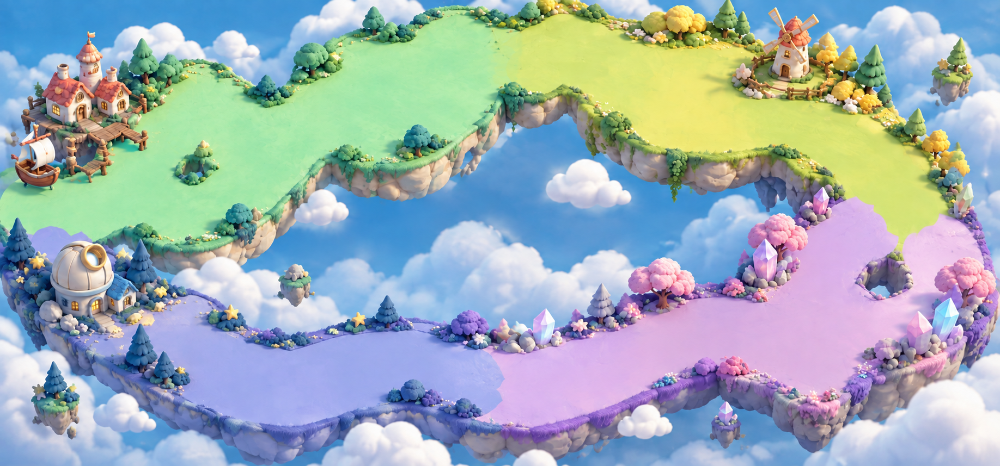
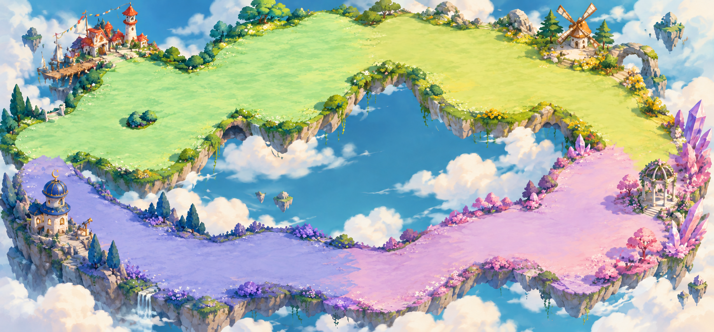
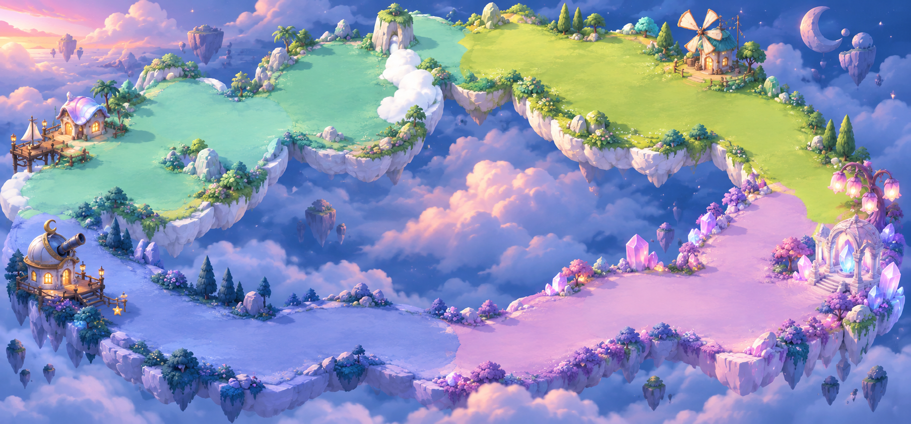

# 云港全地图：三版背景候选

2026-09-23 · 使用内置 ImageGen 生成三版整张四区地图的风格候选。

用户已选择「03 梦幻水晶云港」，按用户附件适配道路与节点。
选定源、精确布局及运行时裁切记录见 [crystal-v1](../../crystal-v1/README.md)。
以下保留三版最初的风格对比，01/02 不进入运行时。

## 01 · 温暖黏土玩具岛

圆润、明亮、像精心搭建的玩具小世界。最适合与当前可爱角色搭配。

## 02 · 清透童话绘本

手绘笔触、轻盈云海、温暖的小建筑，像可游玩的童话插画。

## 03 · 梦幻水晶云港

夕照、星光和发光水晶，梦幻感与冒险氛围最强。

提示词保存在 [prompts.md](prompts.md)，原图路径、尺寸与 SHA-256 见 [manifest.json](manifest.json)。
03 的游戏内验收状态由新目录 manifest 记录；原始三张风格候选保持完整。
