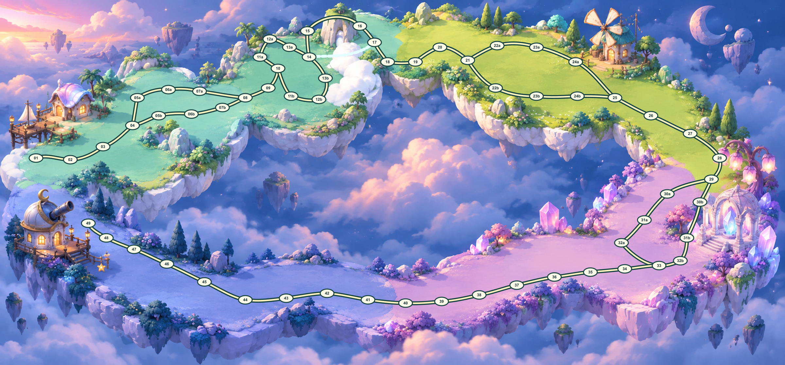

# 梦幻水晶云港 · 用户选定背景

2026-09-23 用户选择候选 03，并要求节点、道路与不同地形自然贴合。
`selected-user-source.png` 保存用户附件原始字节。它与候选 03 的 RGB 像素完全相同，
但 PNG 编码和文件 SHA-256 不同；选定源以本目录附件为准。

背景不绘入棋格、道路、文字或 HUD。道路、节点、运输和分岔继续来自
`ximitu-card-hunt-board.v1@2.2.0`；节点身份、全部边、条件、运输目标与规则不变。
坐标及明确道路曲线作为新版本发布；旧 2.1.0 图和引导图完整保留。

- `world-01-master-crystal-v1.png`：选定源规范到 2400 × 1120，未做创意改图。
- `layout-guides/`：同一 BoardTemplate 自动导出的四区 1:1 引导图。
- `world-01-imagegen-control-guide.svg` / `.png`：新几何的静默空间控制图。
- `world-01-route-alignment.svg` / `.png`：背景上叠加权威路径和节点的审阅图。
- `asset-preparation.json`：缩放、裁切、编码器版本和资源哈希。
- `manifest.json`：精确版本、源文件、四区布局契约、完整棋盘及规则摘要、验收状态。

四张运行时 JPEG 位于 `public/assets/board-themes/cloud-harbor/regions/`，文件名为
`zone-01-crystal-v1.jpg` 至 `zone-04-crystal-v1.jpg`。四张均裁自同一母版，左侧上下区
继续保留 60 px 同源重叠，合计 744,848 bytes。旧 `zone-*-v3.jpg` 未覆盖。



使用已安装的 `sharp` 重新导出（若工具包不在仓库依赖中，用
`GAME_ART_SHARP_MODULE` 指定其模块路径）：

```sh
node scripts/prepare-crystal-harbor-assets.mjs
node scripts/export-crystal-harbor-verification.mjs
node --test tests/crystal-harbor-layout.test.js
```

只改坐标/曲线时运行第二条即可；不得重新生成或改写旧区域资源。
整图审阅图是代码生成的静态对齐证据，真实游戏交互、回退和移动验收以主任务浏览器
结果为准；当前验收状态记录在 `manifest.json` 的 `qa` 中。
