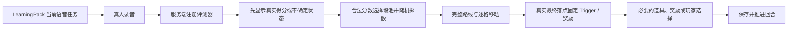

# 通用声控派对棋引擎 · 工程基线

> 2026-10-28：新局默认[同图个人绕圈](CLOUD_HARBOR_CIRCUIT.md)，使用 `route.ximitu-circuit@1.0.0`。本文共享向前远征的世界迁移和历史实现状态属于旧路线基线；旧局保留，新局不再进入第二空间。正式评分和回合顺序保持原样。

> 2026-10-19 最新奖励决定：[只保留最终停格家园积分](POINTS_ONLY_REWARDS.md)。旧金币、星星、骰面附加奖、兑换和整局参与奖已退役；下文相关内容仅作历史兼容。保留真实语音评分、骰点概率、路线和地图设施，历史资产不折算、不补发。

2026-09-07 奖励与存档更新见 [单局星星规则](SESSION_STAR_ECONOMY.md)。
章节 Session 与资产 gameId 分离；金币/星星在同局累计，新局归零，手动结束后封存。
星星直接奖励及兑换无需卡片目录；旧卡片按张数幂等迁为星星。

2026-09-23 当前新局美术组合更新：用户选择「梦幻水晶云港」，使用
`ximitu-card-hunt-board.v1@2.2.1`、`cloud-harbor@2.2.1`、
`world.ximitu.cloud-harbor@1.2.1`、`route.ximitu-main@1.2.1`。
61 个节点与 65 条边的规则、分岔、运输目标和奖励保持一致；只校准坐标、道路曲线与美术。
旧 2.1.0 / 1.1.0 发布组合独立冻结并继续注册，已存在的棋局仍按原版本恢复。
当前引导图、同源裁切与几何摘要见 `art-source/cloud-harbor/crystal-v2/manifest.json`，
验收见 [梦幻水晶云港](CRYSTAL_HARBOR_SCENE_V1.md)。下方旧工程截图、里程碑与示例版本
属于历史基线，不表示旧棋局被替换或旧图已删除。

- 状态：Local Playable Session + Sentence ASR Slice v0.4
- 日期：2026-07-28
- 世界扩展补记：2026-07-30
- 节点奖励编辑补记：2026-08-02
- 落点题目层废止补记：2026-08-06
- 目标：同一个 2D 声控棋盘运行时，在不修改引擎代码的情况下容纳任意已注册知识内容
- 工程验证页：`/prototypes/universal-board/`
- 通用 LearningPack Schema：
  [`universal-learning-pack.v0.schema.json`](./schemas/universal-learning-pack.v0.schema.json)
- 验证截图：
  - [方位介词 × 云港主题](../output/playwright/universal-board-engine-proof-1440.png)
  - [科学概念 × 轨道实验站](../output/playwright/universal-board-engine-proof-science-orbit-1440.png)
  - [通用活动容器](../output/playwright/universal-board-engine-proof-activity-1440.png)
  - [云霄大炮发射途中](../output/playwright/universal-board-launcher-flight-1440.png)
  - [发射后确定落点](../output/playwright/universal-board-launcher-landed-1440.png)
  - [8 人映射为 4 队](../output/playwright/universal-board-launcher-8-players-1440.png)
  - [早期四区导航（历史截图，现行世界结构见下文）](../output/playwright/universal-board-large-map-zones-1440.png)
  - [视口外彩虹峡谷区域](../output/playwright/universal-board-large-map-zone3-1440.png)
  - [8 人 / 4 队 / 1024 宽度](../output/playwright/universal-board-large-map-8-players-1024.png)
  - [完整棋局开局设置](../output/playwright/universal-board-full-game-setup-1440.png)
  - [共享 Boss 终章](../output/playwright/universal-board-full-game-boss-1440.png)
  - [非能力排名式结算](../output/playwright/universal-board-full-game-results-1440.png)
  - [8 人 / 4 队完整棋局](../output/playwright/universal-board-full-game-8-players-1440.png)
- [完整句 ASR 控制台与未配置降级态](../output/playwright/universal-board-asr-playing.png)
- [真实浏览器音频链路通过后进入共享终章](../output/playwright/universal-board-real-asr-browser-boss.png)
- [8 人 / 4 队标定后完整结果](../output/playwright/universal-board-8-player-asr-calibration-result.png)
- [教师复核放行但不增加掌握星](../output/playwright/universal-board-teacher-review-result.png)
- [2026-07-28 真实百炼 ASR 标定记录](./VOICE_BOARD_ASR_CALIBRATION_2026-07-28.md)

首轮直链灰度验收完成后，《云港卡片大搜寻》已作为第二个正式入口加入游戏大厅，
页面地址仍为 `/prototypes/universal-board/`。大厅与游戏文档都要求有效登录态，
现有《单词声波防线》入口和课堂数据保持不变。生产配置必须 fail-closed 隐藏并
拒绝工程模拟、活动预览和发射器演示控件；只有本地明确返回
`qaEnabled=true` 且 URL 显式带有 `qa=1` 时，测试文档才允许免登录验收。

## 1. 对上一版的纠正

上一版把首批知识点泄漏进了游戏本体：

- 棋盘终点固定为 Family Tree。
- 句子种子固定为 He/She、be、have/has、数量、可数性和家庭关系。
- AI 奇遇示例固定要求 `haveForm`、家庭成员和苹果。
- 美术稿把 Family Tree 画成地图的永久终点。

这只能形成一个 Family 单元专用游戏，不能称为万能容器。

正确原则是：

> 棋盘只负责玩；教学包只负责教；主题包只负责长什么样；活动模板只负责如何参与。

Family、have/has、Power Up 人物以后只能作为可替换的 `LearningPack` 和
`AssetPack`，不允许出现在引擎状态机、棋盘拓扑或通用活动组件中。

## 2. 能否由 Codex 实现

可以，但不能把一张生成式海报直接转换成游戏。

适合当前仓库的实现路线是：

- 原生 ES Modules 管理状态和渲染器。
- SVG 表达固定棋盘图、路径、棋格和棋子。
- HTML 表达 HUD、语音任务卡、教师控制和活动浮层。
- CSS `transform`、`opacity` 和少量 SVG 属性完成逐格移动、骰子、传送、
  宝箱和奖励动画。
- Node.js 服务端权威处理答案接受、骰子、路径、落点、回合和存档。
- 阿里云 ASR 只提供 final transcript；服务端评测器决定
  `accepted / retry / teacher_review`。

不需要 Three.js、WebGL、物理引擎或运行时 AI 生图。

### 当前已经完成

- 2400 × 1120 世界画布、1200 × 620 固定视口；World 01 为 61 节点四区棋盘，
  World 02 为 62 节点四区棋盘。
- `WorldPack` / `WorldRoute` 注册表：每次最多挂载当前世界的四个区域，出口只向前
  连接下一世界；出口格消耗正常一步，零步耗穿越后在下一世界继续剩余骰点。
- 四组分岔汇合、鼠标/触控拖动、边缘阻尼、方向键浏览与缩略图导航。
- 棋子逐格移动时的自动镜头跟随，以及“回到当前棋子”入口。
- 两个可独立切换的主题包。
- 四个彼此无关的教学包：家庭成员与 have/has、方位介词、日常动作、基础科学概念。
- 四个声明式活动模板。
- 旧 owner-only ClassroomEventProgram 仍可兼容读取历史数据，但新 Session 不再装载；
  最终落点只结算地图 Trigger、道具和奖励。
- “完整句 ASR 判定 → 自动骰子 → 逐格移动 → 落点奖励/活动”的浏览器链路；
  未配置云端密钥时保留工程模拟入口。
- 独立 `/ws/voice-board-asr` Transcript Gateway：浏览器只提交课堂、回合、
  尝试、内容包版本和任务 ID，标准答案与 ASR context 由服务端锁定。
- 百炼 `fun-asr-realtime` 完整句窗口，当前使用 1300ms 句末静音；interim
  只更新转写，首个 final 才进入判定，重复 final 不重复结算。
- 首个服务端任务评测器，统一返回 `accepted / retry / teacher_review`；
  完整主答案和完整关键词触发均会直接进入自动投骰，不需要第二条口令。
- 教师确认模糊结果、retry 不消耗回合、主目标通过/关键词触发/教师放行分开
  记录，只有主目标通过增加掌握星。
- 数据驱动的发射器跳步：同一机制可换成云霄大炮或轨道弹射器。
- 开局设置、1–8 人全局座位公平轮转、每人最低发言机会和 1–4 队自动映射。
- 每名学生拥有独立题目循环：新局随机起点、相邻座位错峰、个人完成整套题目后才重复，
  刷新恢复继续沿用本局进度，避免固定座位与固定题目长期锁相。
- 共享知识星、共享 Boss 终章、公开冒险收藏和教师私有发言记录。
- 关键结算先落本地快照；刷新后可恢复人数、轮转位置、棋盘位置、Boss 或结算态。
- `attemptId` 去重、注册交互/评测器交叉校验和纯文本 DOM 渲染。
- 纯规则模块单元测试。
- 本机 Codex 已安装 `~/.codex/skills/svg-imagegen-game-art/`，把 SVG 拓扑、
  ImageGen 区域图、节点皮肤、路线纹理、回退图形和浏览器验收固化为同一工作流。

### 当前尚未完成

- 正式服务端课堂 Session。
- 服务端权威骰子、路径事务和效果 Outbox。
- 通用 Evaluator Registry 与更多任务评测器；当前已完成首个服务端锁定评测器。
- 使用真实阿里云账号和儿童语音完成端到端噪声、停顿与口音标定。
- 跨设备、跨浏览器的多人队列持久化；当前只完成同浏览器 `localStorage` 恢复。
- 正式 LearningPack / ThemePack / ActivityTemplate Store。
- 教师工作台、Codex MCP 写草稿、校验和发布链路。

所以当前结果是“已接入完整句 ASR 的本地垂直切片”，仍不是具备服务端权威
棋局 Session 的生产游戏。本机未注入阿里云密钥时，只能验证网关协议、假上游
集成和浏览器降级态；真实儿童语音仍需在有密钥的环境完成课堂标定。

## 3. 版本化组合模型

```text
GameRelease
├── EngineContract
├── DicePack
├── WorldRoute
│   └── WorldPack[]（每个最多四个区域）
│       ├── BoardTemplate
│       ├── ThemePack
│       └── LevelPack
├── RewardDefinition[]
├── NodeRewardPack
├── LearningPack
├── AssessmentPolicy
├── ActivityTemplate[]
├── Legacy ClassroomEventProgram（只读迁移，可省略）
├── MaterialCapability
├── AssetPack[]
└── SessionConfig
```

| 层 | 负责 | 不能包含 |
|---|---|---|
| EngineContract | 回合、骰子、路径、结算、存档、幂等 | 教材、具体知识点、任意 AI 代码 |
| DicePack | 六种骰子的六个等概率实体面、点数与受限面奖励 | 分数阈值、题目、地图、本轮指定结果 |
| WorldRoute | 不可变世界版本之间的单向出口连接，以及显式安全的终端实例续接 | 世界内部道路、知识内容、普通循环回边 |
| WorldPack | 组合一个可独立装载/卸载的 Board、Theme 与 Level | LearningPack、题目、评分证据 |
| BoardTemplate | 节点、边、分岔、传送、空间插槽 | Family、时态、单词和题目 |
| ThemePack | 配色、地标、棋格皮肤、角色和音效 | 判定逻辑、路线概率 |
| LevelPack | 剧情、节点奖励绑定、地图资源和地图状态 | 知识答案、ASR 证据 |
| RewardDefinition | 最终落点奖励的纯规则与表现引用 | 题目、transcript、得分 |
| NodeRewardPack | 精确 Board/Level 版本下纯资源槽的受限逐节点覆写 | 普通节点、固定机制、坐标、骰子、评分与任意脚本 |
| LearningPack | 目标、任务、提示、素材、评价配置 | SVG 坐标、骰子和计分 |
| AssessmentPolicy | 正确形式、证据要求、权重和评分动作 | 地图、世界路线、节点奖励 |
| ActivityTemplate | 画、找、分类、修复、接力等活动阶段 | 固定知识点和任意脚本 |
| Legacy ClassroomEventProgram | 只读兼容旧发布数据，不进入新 Session | 新题目、系统 Trigger、评分、奖励、骰子、移动、路线、地图状态与任意脚本 |
| MaterialCapability | 教室当前能使用的线下材料 | 题目与学习证据 |
| AssetPack | 图片、声音、角色、动画帧 | 运行时代码 |
| SessionConfig | 1–8 人、组队、时长、轮次和教师选项 | 教学题目和主题美术 |

`GameRelease` 只引用以上各包的不可变版本。Board、Theme 和 Level 由
`WorldPack` 组合，跨世界关系只由 `WorldRoute` 声明：

```json
{
  "kind": "GameRelease",
  "id": "release.ximitu-card-hunt",
  "version": "2.1.0",
  "engineRef": "voice-party-engine@1.0.0",
  "worldRouteRef": "route.ximitu-main@1.1.0",
  "learningPackRef": "science-basics@1.0.0",
  "assessmentPolicyRef": "assessment-policy.v2@1.0.0",
  "classroomEventProgramRef": "voice-board-classroom-event-program.v1@revision-1",
  "activityTemplateRefs": [
    "draw-and-explain@1.0.0",
    "sort-and-say@1.0.0"
  ],
  "materialCapabilityRef": "tim-classroom@2.1.0",
  "assetPackRefs": ["generic-pawns@1.0.0"],
  "sessionConfigRef": "two-teams-six-seats@1.0.0"
}
```

## 4. EngineContract

引擎是固定程序，Codex 只能读取能力，不能修改规则。

```json
{
  "kind": "EngineContract",
  "id": "voice-party-engine",
  "version": "1.0.0",
  "capabilities": [
    "speech.final-transcript",
    "evaluation.registered-policy",
    "board.directed-graph",
    "board.auto-roll-after-accept",
    "activity.declarative-template",
    "teacher.review"
  ],
  "lockedPolicies": {
    "acceptedAction": "AUTO_ROLL_DICE",
    "randomPolicyRef": "secure-d6-v1",
    "turnPolicyRef": "equal-opportunity-v1",
    "scorePolicyRef": "classroom-balanced-v1"
  }
}
```

以下规则只能存在于服务端：

- 答案被接受后自动投骰。
- 骰子随机算法与概率。
- 结算、金币和胜负规则。
- 回合顺序和追赶机制。
- 同一 ASR final 的幂等键。
- 教师覆盖的审计记录。

LearningPack 无权请求“投出 6 点”“额外加分”或“直接到终点”。

## 5. BoardTemplate

棋盘只描述可通行空间：

```json
{
  "kind": "BoardTemplate",
  "id": "branching-board",
  "version": "1.0.0",
  "viewBox": [0, 0, 1200, 620],
  "worldSize": {"width": 2400, "height": 1120},
  "zones": [
    {"id": "zone-01", "bounds": {"x": 0, "y": 0, "width": 1200, "height": 620}},
    {"id": "zone-02", "bounds": {"x": 1200, "y": 0, "width": 1200, "height": 560}},
    {"id": "zone-03", "bounds": {"x": 1200, "y": 560, "width": 1200, "height": 560}},
    {"id": "zone-04", "bounds": {"x": 0, "y": 560, "width": 1200, "height": 560}}
  ],
  "entry": {"id": "main", "nodeId": "n01"},
  "exits": [
    {
      "id": "forward",
      "nodeId": "n49",
      "transitionProfileRef": "world.portal.forward.v1"
    }
  ],
  "nodes": [
    {
      "id": "n01",
      "x": 80,
      "y": 520,
      "spaceRole": "learning",
      "slotTag": "core-task"
    },
    {
      "id": "n05b",
      "x": 375,
      "y": 505,
      "spaceRole": "activity",
      "slotTag": "group-activity"
    },
    {
      "id": "n06a",
      "x": 465,
      "y": 300,
      "spaceRole": "transport",
      "transportProfileRef": "jump.launcher.v1",
      "transportTargetId": "n13a"
    }
  ],
  "edges": [
    {"id": "e01", "from": "n01", "to": "n02"},
    {"id": "e04a", "from": "n04", "to": "n05a", "order": 0},
    {"id": "e04b", "from": "n04", "to": "n05b", "order": 1}
  ]
}
```

节点只认识空间角色：

- `learning`
- `reward`
- `item`
- `treasure`
- `transport`
- `activity`
- `junction`
- `goal`

`goal` 只是一种地标/出口视觉角色，不代表课堂 Session 结束。节点只有被
`BoardTemplate.exits` 显式声明后才是 forward exit；它在云港主题中可以叫“远航
信标”，在轨道主题中可以叫“星际信标”，换主题不改变拓扑，也不得回到本世界入口。

`transport` 只描述确定的位移规则。目标节点属于经过校验的
`BoardTemplate`，LearningPack 不能填写 `transportTargetId`，因此 Codex
生成题目时无权把孩子送到运输目标、forward exit 或改变棋局概率。

### 5.1 大世界相机契约

`worldSize` 是完整关卡尺寸，`viewBox` 是一次能看到的固定尺寸。相机只存在于
浏览器渲染层，不进入回合状态、存档、骰子或学习内容，因此拖到地图任何位置
都不会改变棋局。

- 鼠标和单指拖动直接跟手；越过边界时使用阻尼，松手后回到合法范围。
- 方向键每次移动固定距离，键盘操作不播放惯性动画。
- 缩略图显示完整路线、棋子和当前视窗，并提供四个可键盘操作的区域入口。
- 棋子走出安全区时镜头自动居中；教师可以随时“回到当前棋子”。
- ASR 接受事件开始结算时会原子取消未结束的拖动，避免拖动和自动跟随争用相机。
- 普通传送同屏播放抛物线；跨度超过单个视口时自动切换为
  “起飞—跨区镜头—落地”，不会让棋子飞出裁剪层后消失。

BoardTemplate 校验会拒绝小于视口的世界、越界节点、越界区域、悬空边和无效
传送目标。相机边界计算保持为纯函数并有独立单元测试。

### 5.2 WorldPack 装载与向前穿越

当前新局注册表的权威结构（历史 World 1.1.0 / Board 2.1.0 / Route 1.1.0 组合继续供旧棋局恢复）：

| 顺序 | WorldPack | BoardTemplate | 节点 | 区域 | 入口 | forward exit |
|---:|---|---|---:|---:|---|---|
| 1 | `world.ximitu.cloud-harbor@1.2.1` | `ximitu-card-hunt-board.v1@2.2.1` | 61 | 4 | `n01` | `n49` |
| 2 | `world.ximitu.beyond-cloud@1.0.0` | `ximitu-card-hunt-world-02.v1@1.0.0` | 62 | 4 | `w2n01` | `w2n52` |

`route.ximitu-main@1.2.1` 当前声明 World 01 → World 02，并把 World 02 明确注册为
`append-new-instance-v1` 的 `repeatableTail`。到达出口节点消耗骰子的正常一格，
`world_transition` 固定消耗 0 格；当前棋子的剩余骰点从下一世界实例入口继续逐格
走完，最终只结算完整路线的最后落点。

World 02 的 `w2n52` 在新的后继 WorldPack 发布前会复用同一个不可变四区模板，但
每次必须创建不同的 `instanceId`、把 ordinal 加一，并使用 World 02 的初始 map/level
state；全员迁移后旧实例只归档，绝不回访。普通 WorldRoute self-edge 仍然非法。

运行时只保留当前 `WorldPack` 的一个棋盘 SVG 和最多四张区域图。切换时卸载旧世界
DOM 与图片强引用；个人账本、卡片、课堂机会和共享远征状态继续保留。

## 6. ThemePack

主题包只控制外观与声音：

```json
{
  "kind": "ThemePack",
  "id": "orbit-lab",
  "version": "1.0.0",
  "palette": {
    "page": "#eaf2ff",
    "terrain": "#f7f4ff",
    "primary": "#ffca52",
    "accent": "#8a72f4"
  },
  "landmarks": [
    {"slot": "start", "label": "发射舱", "assetRef": "landmark.launch-bay"},
    {"slot": "goal", "label": "星际信标", "assetRef": "landmark.beacon"}
  ],
  "transportSkins": {
    "jump.launcher.v1": {
      "label": "轨道弹射器",
      "deviceVariant": "rail-launcher",
      "announcement": "锁定轨道捷径！"
    }
  },
  "soundRefs": {
    "dice": "sound.dice.paper",
    "launcherCharge": "sound.launcher.charge",
    "launcherLand": "sound.launcher.land"
  }
}
```

同一个科学 LearningPack 可加载云港或轨道主题；同一个轨道主题也可加载
英语、数学、科学或阅读理解内容。

### 6.1 发射器跳步契约

棋子只有在回合移动结束后落在 `transport` 格时才触发；普通路过不会发射。
服务端先在同一回合事务中确定目标与最终状态，再
写入 Effect Outbox：

```json
{
  "type": "transport_move",
  "effectId": "asr-attempt-17:effect:7",
  "transportProfileRef": "jump.launcher.v1",
  "actorTeamId": "sun",
  "fromNodeId": "n06a",
  "toNodeId": "n13a"
}
```

浏览器只消费这个效果，按顺序播放：

1. 发现捷径与装填提示。
2. 发射器蓄力和后坐。
3. 棋子沿抛物线飞行。
4. 目标格落地冲击并恢复回合 HUD。

云港 ThemePack 将它画成“云霄大炮”，轨道 ThemePack 将它画成“轨道
弹射器”；规则与目标完全相同。以后还可增加弹簧、魔法投石机或火箭皮肤，
无需改变 LearningPack。

正常动效约 1.5 秒，8 人快节奏模式可缩短；启用
`prefers-reduced-motion` 时改为约 0.2 秒的起点淡出、目标淡入和落点高亮。动画失败
也不能改变服务器已经提交的目标节点。

## 7. LearningPack

这是 Codex 主要创建和修改的内容。

通用任务不使用 `family_relation`、`have_verb` 等写死类型，而使用：

```json
{
  "id": "science-state-01",
  "objectiveIds": ["science.states"],
  "interactionTemplateRef": "voice.single-response.v1",
  "presentationRef": "prompt.scene-and-frame.v1",
  "evaluatorRef": "concept-frame.v1",
  "content": {
    "prompt": "判断物质状态，并用完整内容表达。",
    "mediaRefs": ["asset.water-cup"],
    "sentenceFrame": "Water is a ___."
  },
  "evaluatorConfig": {
    "requiredConceptIds": ["water", "liquid"],
    "minimumCompletenessRef": "full-proposition.v1"
  },
  "feedback": {
    "modelContent": "Water is a liquid."
  },
  "activityBindings": [
    {
      "templateRef": "sort-and-say.v1",
      "parameterRef": "science.states.sorting-01"
    }
  ]
}
```

同一个结构可容纳：

- 英语词汇、语法、自然拼读、阅读理解。
- 数学口述、比较、运算步骤。
- 科学分类和概念解释。
- 中文表达、故事排序和复述。
- 教师以后注册的其他受控评价方式。

若系统没有能可靠评价的新任务类型，必须使用 `teacher-confirmed.v1`，
不能让大模型在课堂运行时自由判分。

## 8. ActivityTemplate

活动模板是已经由工程实现和测试的通用组件：

```json
{
  "kind": "ActivityTemplate",
  "id": "draw-and-explain",
  "version": "1.0.0",
  "renderer": "hybrid.activity.v1",
  "materialRequirements": {
    "allOf": ["drawing.paper", "drawing.color-tools"],
    "optional": ["camera.teacher-device"]
  },
  "phases": [
    {"op": "announce"},
    {"op": "prepare-materials"},
    {"op": "physical-action"},
    {"op": "individual-response"},
    {"op": "teacher-confirm"},
    {"op": "celebrate"}
  ]
}
```

允许的 `op` 来自白名单；内容包不能注入 JavaScript、HTML、CSS、
表达式、回调地址或任意网络请求。

首批通用模板：

- `speak-from-scene.v1`
- `repair-together.v1`
- `draw-and-explain.v1`
- `sort-and-say.v1`
- `physical-fetch.v1`
- `build-and-say.v1`
- `voice-relay.v1`
- `teacher-mystery-bag.v1`

例如 `draw-and-explain.v1` 今天可以画家庭成员，明天可以画天气、动物、
植物生长条件、故事地图或几何图形。活动组件本身不知道知识点。

### 8.1 掷骰前题目与最终落点边界

题目、答案、真人录音和评分依据只属于掷骰前的 LearningPack / Task Pack。奖励、发现、
机关、运输、portal、goal、world transition 等属于地图 Trigger，由 Board / Level /
Reward / Trigger 数据定义。

- 新 Session 不装载 `ClassroomEventProgram`，最终落点不创建课堂 Activity。
- 旧程序只保留只读迁移能力，不能新增或发布。
- 节点编辑器只能选择地图 Trigger、道具和奖励，不得包含题目、答案、transcript、score、
  evaluator、脚本或回调地址。
- 完整路线的真实最终落点只结算一次；随后保存并推进回合。

## 9. 运行时连接



活动或任务只能返回标准结果：

```json
{
  "result": "accepted",
  "taskId": "science-state-01",
  "evidence": {
    "transcript": "Water is a liquid.",
    "matchedConceptIds": ["water", "liquid"]
  }
}
```

初始语音任务不能直接指定骰点或路径；最终落点不会创建第二个题目、录音、评分、骰子
或移动流程。

## 10. 1–8 人

人数与棋子数分开：

- 1–4 人可一人一枚棋子。
- 5–8 人自动组成 2–4 队。
- 地图最多出现 4 枚队伍棋子。
- 每队独立维护 `speakerQueue`。
- 当前发言学生和当前队伍棋子是两个状态。
- 教学证据按学生保存，游戏资源按队伍保存。
- 调度器优先选择发言机会最少的学生。
- 题目调度与座位轮转彼此解耦：每名学生单独记录本局已完成题数；同一学生在题库未完整
  轮换前不得重复题目。新 Session 只随机一次共同起点并保存到快照，相邻学生使用错峰
  偏移；刷新不得重抽起点或重置个人题目进度。

ActivityTemplate 根据人数分配实体角色，但不能把某个孩子公开标为最差。

## 11. Codex 自然语言创作

教师可以说：

> 用轨道实验站主题，给 8 岁孩子设计 12 分钟内容。知识点是方位介词、
> 一般现在时和三种物质状态。加入一次用画纸解释的活动，6 个孩子分两队。

Codex 执行：

1. `catalog.list`
2. 读取可用 BoardTemplate、ThemePack、ActivityTemplate、Evaluator、
   MaterialCapability 和 AssetPack。
3. `learningDraft.create`
4. 把自然语言转为 LearningPack 草稿。
5. `learningDraft.validate`
6. 检查 Schema、目标覆盖、活动材料、人数公平、时长和媒体引用。
7. `learningDraft.simulate`
8. 用固定随机种子模拟任务耗尽、分岔、事件、掉线和重复 ASR。
9. `learningDraft.preview`
10. 教师人工确认。
11. 教师在网站发布不可变版本。

Codex 权限：

| 对象 | 读取 | 创建草稿 | 修改规则 | 发布 |
|---|---:|---:|---:|---:|
| EngineContract | 是 | 否 | 否 | 否 |
| DicePack | 是 | 项目所有者 | 仅六个实体面及受限奖励 | 项目所有者 |
| NodeRewardPack | 是 | 项目所有者 | 仅既有纯资源槽及受限数量 | 项目所有者 |
| Legacy ClassroomEventProgram | 仅迁移读取 | 否 | 否 | 否 |
| BoardTemplate | 是 | 否 | 否 | 否 |
| ThemePack | 是 | 仅引用 | 否 | 否 |
| LearningPack | 是 | 是 | 仅草稿内容 | 否 |
| ActivityTemplate | 是 | 仅参数化 | 否 | 否 |
| MaterialCapability | 是 | 否 | 教师维护 | 否 |
| AssetPack | 是 | 可生成待审素材 | 否 | 否 |

## 12. 安全 Schema 约束

- 所有 Schema 使用 `additionalProperties: false`。
- 禁止字段：`script`、`code`、`expression`、`callbackUrl`。
- LearningPack 禁止字段：`probability`、`diceWeight`、`points`、
  `winner`、`moveToNode`。
- 不执行内容中的 HTML、CSS、JavaScript 或 SVG 脚本。
- 评测器和活动操作只引用注册表 ID。
- 素材只引用内部 storage ID 与哈希。
- 一场 Session 锁定所有包版本，中途不能热替换。
- DicePack 每种骰子必须恰好六面、点数为 1–6、每面最多一种受限奖励；禁止
  `scoreThreshold`、`weight`、`faceIndex`、`roll` 和任意脚本字段。
- 发布版本不可原地修改，只能创建新 revision。
- NodeRewardPack 必须完整覆盖精确 Board/Level 的全部节点；只允许
  `none / coin / card_case`，固定机制和普通 no-op 节点必须保持 `none`。
- 新 Session 不引用 ClassroomEventProgram；节点 Trigger 数据禁止题目、答案、录音、
  transcript、score、evaluator、script、HTML、CSS、expression 和 callbackUrl。

当前已实现 owner-only DicePack 严格校验、原子持久化、乐观 revision、编辑器发布与
本地 Session 完整快照锁定。正式服务端权威摇骰仍属于待完成的服务端课堂 Session 工作；
现有浏览器运行时继续从锁定快照的六个合法实体面等概率抽取，不能把它描述为已完成的
服务端权威随机。

当前也已实现 owner-only NodeRewardPack 严格校验、原子持久化、乐观 revision、逐节点
编辑器与本地 Session v12 完整快照锁定。编辑器列出两个世界的全部节点，只解锁既有
纯资源槽；同一快照驱动节点展示和最终落点资源到账，发布新版本只影响新棋局。该能力
不改变评分、骰子档位、实体骰面随机抽取、路线提交或逐格移动。

旧 owner-only ClassroomEventProgram 的存储与校验代码仍作为迁移兼容存在；2026-08-06
起不再向新 Session 注入，不再显示发布入口，运行时也不在最终落点追加 Activity。

## 13. 生产实现分期

### Slice 1：浏览器工程验证

- 已完成。
- 证明 BoardTemplate、ThemePack、LearningPack 和 ActivityTemplate 可独立组合。
- 未配置真实 ASR 时，“工程模拟：完整内容通过”仅作为开发验证入口。

### Slice 2：服务端棋盘核心

- 纯规则 `board-core`。
- 服务端 Session、幂等命令和 Effect Outbox。
- 安全骰子、路径、传送、奖励和刷新恢复。
- 单元测试与固定随机种子整局模拟。

### Slice 3：完整内容判定

- 已完成：专用 Transcript Gateway、服务端锁定任务上下文、首个 Registered
  Evaluator、当前任务 context、教师确认和重复 final 幂等。
- 待完成：通用 Evaluator Registry、教师修正转写与证据修订、真实儿童语音
  的停顿/噪声/口音标定。

### Slice 4：正式运行 UI

- SVG 棋盘只初始化一次。
- 局部更新棋子、HUD、路径和活动浮层。
- 1–8 人、减少动态、1024×768 和 1440×900。
- 音效与所有非关键动画可跳过。

### Slice 5：内容后台与 Codex

- 独立 LearningPack Store。
- Catalog、Schema、模拟器、预览与发布。
- MCP 只读目录、写草稿、校验和提交审核。

## 14. 产品级验收

1. 不修改 JS、CSS 或 SVG，切换三套互不相关的 LearningPack。
2. 不修改 LearningPack，切换两套 ThemePack。
3. 同一个 ActivityTemplate 能绑定英语和科学内容。
4. accepted 后只自动投骰一次；retry 不投骰。
5. 重复 ASR final 不重复投骰、移动或奖励。
6. 服务端决定骰子、路径和落点。
7. 刷新后恢复回合、棋子、资源和发言队列。
8. 8 名学生映射为最多 4 枚棋子，机会均等。
9. 阿里云不可用时，教师确认仍能继续。
10. 任意内容包都不能注入代码、改概率或改计分。

满足这十条后，才能正式称为“万能知识点容器”。
